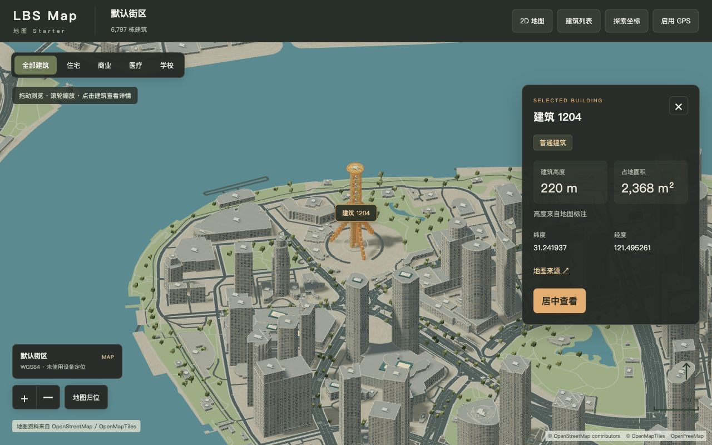

# LBS Map Starter

[Full demo](https://lbs-map-starter.aileetcode.com) · [Neighborhood preview](https://icesixgod.github.io/lbs-map-starter/) · [简体中文](README.md)

A **Three.js + OpenStreetMap** starter for location-based games, neighborhood exploration and building interaction.

[](https://lbs-map-starter.aileetcode.com)

- Pan, pinch to zoom and switch between 2D/3D, with a bundled Shanghai neighborhood.
- Select connected building parts as one building; highlight, search, filter and inspect details.
- Streamed map loading, coordinate exploration and optional GPS positioning.

## Run

Requires **Node.js 20+**. No dependency installation or API key needed.

```sh
git clone https://github.com/icesixgod/lbs-map-starter.git
cd lbs-map-starter
npm start
```

Open [http://localhost:8789](http://localhost:8789/). The full demo supports online exploration; the neighborhood preview covers the bundled area. GPS requires permission. The application UI is in Chinese.

## Develop

```sh
npm run build       # Generate dist/index.html
npm run build:demo  # Build the demo for static hosting
npm run verify      # Build, test and check
```

[Setup and deployment](docs/getting-started.md) · [Customization](docs/customization.md) · [Architecture](docs/architecture.md) (Chinese)

Code: [MIT](LICENSE). Map data: © [OpenStreetMap contributors](https://www.openstreetmap.org/copyright), ODbL. See [third-party notices](THIRD_PARTY_NOTICES.md). Building heights may be estimated; facades are procedural.
